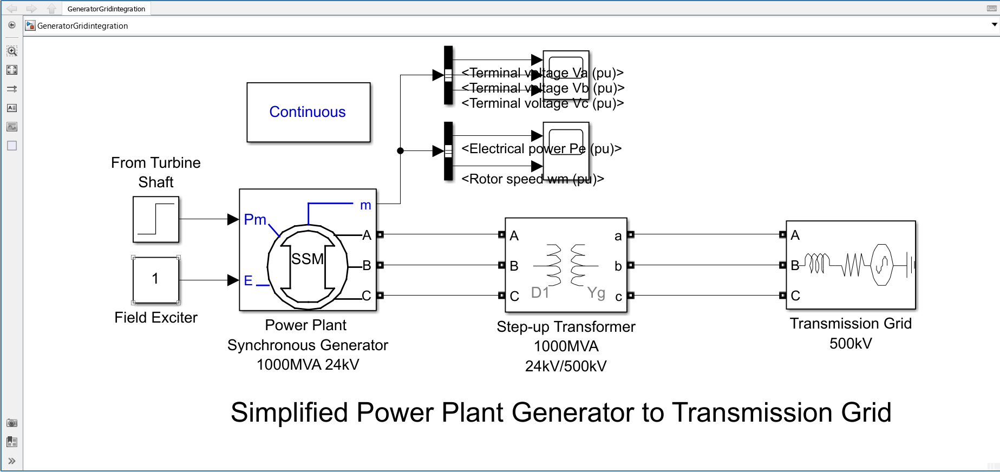
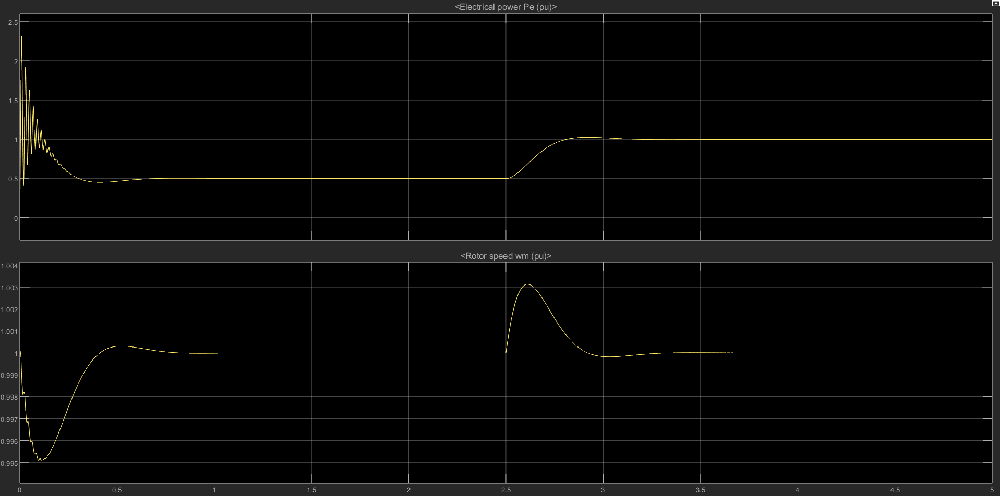
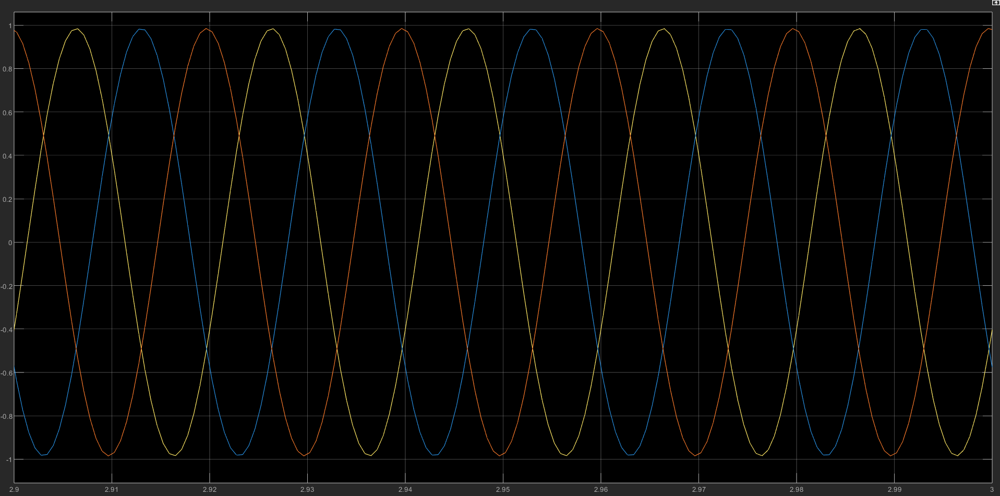

# Power Plant Generator and Grid Integration Analysis

A MATLAB/Simulink model of a simplified power plant generator connected to a high-voltage transmission grid through a step-up transformer.

## Project Overview

This project models a synchronous generator connected to a 500 kV transmission grid through a 24/500 kV step-up transformer. The simulation is used to observe generator electrical power, rotor speed, and three-phase terminal voltages under varying mechanical input conditions.

## System Configuration

| Component | Rating / Configuration |
|---|---|
| Synchronous Generator | 1000 MVA, 24 kV, 50 Hz |
| Step-up Transformer | 1000 MVA, 24 kV / 500 kV |
| Transmission Grid | 500 kV, 50 Hz |
| Simulation Environment | MATLAB/Simulink |

## Model Architecture

The model consists of:

1. Simplified synchronous machine
2. Mechanical power input represented by a step signal
3. Field excitation input
4. Three-phase step-up transformer
5. Three-phase transmission grid source
6. Measurement signals and scopes for monitoring system response

## Simulink Model

## Simulation Results

### Electrical Power and Rotor Speed

The generator electrical power and rotor speed are monitored in per-unit values. The mechanical input changes during the simulation, allowing the response of these quantities to be observed.

### Three-Phase Terminal Voltages

The generator terminal voltages are monitored to observe the three-phase output waveform.

## Tools Used

- MATLAB
- Simulink
- Simscape Electrical / Specialized Power Systems

## How to Run

1. Download or clone this repository.
2. Open MATLAB.
3. Navigate to the `model` folder.
4. Open `Power_Plant_Generator_Grid_Integration.slx`.
5. Run the simulation.
6. View the electrical power, rotor speed, and terminal voltage scopes.

## Project Scope and Limitations

This is a simplified generator-to-grid integration model intended for educational and engineering analysis. It does not represent a complete detailed gas-turbine model or a complete generator protection system.

